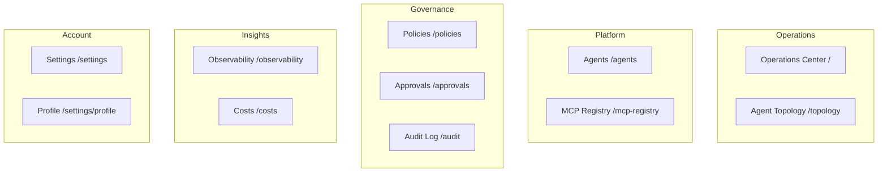

# Application Summary: TROT (Nest Agent POC)

**TROT** is a proof-of-concept **AI workforce operations platform** — an enterprise control plane for deploying, governing, observing, and optimizing fleets of production AI agents. The mock data centers on an insurance/claims domain (Claims Resolution, Fraud Review, Policy Lookup, Triage), but the product patterns apply to any large-scale agent deployment.

This is a **Next.js 16 frontend POC**: all data is mocked, and there is no live backend. The UI is built to demonstrate how platform admins, risk teams, and FinOps operators would run an AI agent fleet day to day.

---

## What Problem It Solves

Organizations running hundreds of autonomous AI agents need more than a model dashboard. They need to:

- See fleet health and operational posture at a glance
- Manage agent permissions, tool access, and governance policies
- Route high-risk decisions through human approval
- Trace failures across agent-to-agent (A2A) chains and MCP tool calls
- Understand blast radius when something degrades
- Control spend and audit every decision

TROT unifies those concerns into one sidebar-driven console branded for **Nest** (`dana.okafor@nest.io`).

---

## Application Structure

The app uses a persistent **left sidebar** (256px) with four navigation sections, a **global status banner**, and shared **page header controls** (global search + environment/time range selectors). Settings is accessed from the account menu, not the main nav.

---

## Identified Pages

### 1. Operations Center (`/`)

The **home dashboard** and command center.

**What it shows:**
- **Operations Posture** — active agents (248/262), governance score (87%), budget utilization (~69% of daily limit), pending approvals (7), average confidence (91%), and A2A handoffs today (2.4M)
- **Workforce narrative guide** — a dismissible timeline walking through the agent lifecycle: Onboard → Govern → Investigate → Audit → Optimize, anchored on incident trace **TRC-7419-A**
- **Quick Actions** — shortcuts to topology, approvals queue, incident trace, and audit
- **Approval Queue preview** — top 3 pending human-review items with confidence vs. threshold
- **Alerts at a Glance** — active alerts tied to specific agents (click opens agent detail)
- **Recent System Traces** — latest distributed traces; clicking navigates to Observability

**Inferred workflow:** An operator lands here each morning to assess fleet health, triage incidents, and jump into deeper investigation or governance work.

---

### 2. Agent Topology (`/topology`)

A **live ecosystem map** of the agent infrastructure.

**What it shows:**
- Interactive graph of nodes: agents, MCP servers, models, APIs, databases, external services
- **Trust zones** (production, restricted, external) with visual boundaries
- Edge types: tool calls, A2A handoffs, model inference, data access, API calls, governance bindings
- **Incident banner** highlighting the active incident (TRC-7419-A)
- **Node inspector** — metrics, status, and metadata for a selected node
- **Blast radius panel** — downstream impact when a node fails

**Inferred workflow:** During an incident, an operator selects a degraded node (e.g., CRM Search MCP) and traces how failure propagates through Claims Resolution → Fraud Review A2A chains — understanding which 847 downstream traces were affected.

---

### 3. Agents (`/agents`)

The **fleet management** view for the AI workforce.

**What it shows:**
- Summary cards (total agents, healthy/warning/degraded counts, autonomy breakdown)
- Filterable/searchable table: name, team, status, autonomy level (Autonomous / Supervised / Manual), volume, latency, error rate, cost per execution
- **Agent detail sheet** (slide-over) with:
  - Profile (owner, model, autonomy, deployment date)
  - Performance metrics
  - Escalation path (e.g., "Customer Ops on-call → Dana Okafor")
  - Approved MCP tools and bound governance policies
  - Links to latest trace and cost breakdown

**Inferred workflow:** A platform admin onboards a new agent version, scopes MCP tool permissions, binds policies, and monitors performance. Clicking a degraded agent leads to trace investigation or policy review.

---

### 4. MCP Registry (`/mcp-registry`)

**Tool server inventory** for Model Context Protocol (MCP) integrations.

**What it shows:**
- Summary cards (total servers, degraded count, connected agents, avg latency)
- **Server grid** — cards per MCP server with status, version, tool count, auth method, p95 latency, cost per call, connected agent count
- **Agents-by-server table** — which agents depend on each tool server
- **Server detail sheet** — endpoint, scopes, schema version, sync status, incident trace links

**Inferred workflow:** When CRM Search MCP exceeds its 2.0s timeout threshold, an operator identifies the degraded server, sees which agents are connected, and correlates to the incident trace.

---

### 5. Policies (`/policies`)

**Governance rule definitions** that constrain agent behavior.

**What it shows:**
- Summary cards (active policies, violations, enforcement modes)
- Filterable policies table: name, scope, category, threshold, enforcement mode (`block`, `warn`, `require-approval`, `audit-only`), bound agents, severity
- **Policy violations table** — live breaches with severity, agent, trace ID, violation type
- **Policy detail sheet** — full rule definition, affected MCP servers/models, violation history

**Policy categories covered:**
- Tool access, model routing, data classification, spending limits, escalation rules, approval checkpoints, latency SLOs, retry limits

**Inferred workflow:** A risk team defines an A2A latency SLO, monitors violations, and drills into the trace that triggered a breach.

---

### 6. Approvals (`/approvals`)

The **human-in-the-loop review queue** and policy change preview.

**What it shows:**
- Governance summary (compliance rate, open violations, pending approvals, recent policy changes)
- **Approval Queue** — items requiring human decision with Approve/Deny actions:
  - Low-confidence actions (auto-resolve claim below threshold)
  - Sensitive data access (SSN queries)
  - Budget threshold breaches
  - Unauthorized tool invocation
  - Recursive A2A loop detection
- **Policy Simulation** — preview impact of proposed policy changes (agents affected, traces blocked, cost impact, approval queue increase, risk reduction)
- Violations table, policy category grid, active policies panel

**Inferred workflow:** An operator clears the approval queue during an incident — e.g., denying a low-confidence auto-resolve or approving continued reasoning within budget — while simulating a tighter A2A latency SLO before deploying it.

---

### 7. Audit Log (`/audit`)

Immutable **decision and change history**.

**What it shows:**
- Summary cards (events today, success/warning/failure breakdown)
- Paginated, filterable event log: timestamp, action, agent, outcome
- **Event detail sheet** — actor, resource, related trace/policy links
- Deep-link support via query params (e.g., `?policy=a2a-latency-slo`)

**Inferred workflow:** After a policy change or approval decision, compliance reviews the audit trail to verify who did what, when, and whether it succeeded.

---

### 8. Observability (`/observability`)

**Distributed tracing** for agent executions.

**What it shows:**
- Trace list (filterable sidebar)
- **Trace summary** — operation, agent, duration, status, team, environment, cost
- **Waterfall view** — span timing with color-coded degradation, retries, nested bars
- **Span details panel** — logs, tags, cost, baseline delta
- Deep-link via `?trace=TRC-7419-A` (also reachable from global search)

**Inferred workflow:** The primary incident investigation path — select a degraded trace, expand the waterfall, inspect the CRM Search span that exceeded timeout, and follow the retry/escalation chain.

---

### 9. Costs (`/costs`)

**FinOps and token budget** visibility.

**What it shows:**
- Summary cards (total spend, budget utilization, avg cost per trace, top spender)
- **Spend by agent** chart (toggleable table view)
- **Spend by model** table (GPT-4.1 vs GPT-4.1-mini breakdown)
- **High-cost traces** table with cost anomaly reasons
- **Cost detail sheet** for individual traces
- Deep-link via `?agent=claims-resolution`

**Inferred workflow:** FinOps reviews daily spend against budget, identifies expensive agents/traces, and validates cost optimizations (e.g., routing triage to gpt-4.1-mini).

---

### 10. Settings (`/settings`) and Profile (`/settings/profile`)

**Account and workspace configuration** (UI shells with mock toggles).

**Settings tabs:**
- Profile — name, role, contact
- Preferences — display and workspace defaults
- Notifications — alerts and digests
- Billing & usage — plan, invoices, limits
- Members — team access and roles
- API keys — programmatic access tokens

**Inferred workflow:** A platform admin manages team access, notification preferences, and API keys for programmatic integration.

---

## Cross-Cutting Features

| Feature | Purpose |
|---|---|
| **Global Search** | Search pages, settings sections, and trace IDs; jump directly to observability |
| **Environment selector** | Production / Staging / Development (triggers loading state) |
| **Time range selector** | Last 1h → 90d (triggers data refresh overlay) |
| **Global status banner** | Production health indicator; links to incident trace or topology |
| **Detail sheets** | Consistent slide-over pattern for agents, MCP servers, policies, audit events, costs |
| **Filterable tables** | Search + facet filters across agents, policies, audit |

---

## Core User Personas & Workflows

### Platform Admin (Dana Okafor)
1. Check Operations Center posture
2. Deploy/onboard agents with scoped MCP access
3. Bind governance policies
4. Monitor fleet health in Agents and MCP Registry

### Risk / Reliability Operator
1. Respond to degraded status banner
2. Investigate trace TRC-7419-A in Observability
3. Map blast radius in Agent Topology
4. Clear approval queue for escalated decisions
5. Review violations and propose policy changes

### FinOps Team
1. Monitor budget utilization on Operations Center
2. Analyze spend by agent/model on Costs
3. Simulate and deploy model routing policies for savings

### Compliance / Audit
1. Review policy changes in Audit Log
2. Verify approval decisions are traceable
3. Confirm enforcement modes and violation handling

---

## Narrative Thread: The TRC-7419-A Incident

The mock data tells a coherent incident story that ties the pages together:

1. **CRM Search MCP** degrades (exceeds 2.0s timeout) during a Claims Resolution execution
2. **MCP Timeout policy** triggers retry with backoff; **Model Retry Limit policy** escalates to human review
3. Failure propagates through **Claims Resolution → Fraud Review A2A chain**, affecting 847 downstream traces
4. Operators investigate via **Observability** (waterfall), **Topology** (blast radius), and **Approvals** (low-confidence auto-resolve queued)
5. Risk team proposes tightening **A2A Latency SLO** (simulated on Approvals, audited on Audit Log)
6. FinOps previously optimized costs via model routing (shown in workforce narrative)

---

## Technical Notes

- **Stack:** Next.js 16 (App Router), React 19, Tailwind CSS 4, Base UI, Lucide icons
- **Data:** Entirely mock/static — no API routes, database, or authentication backend
- **Branding:** TROT logo in sidebar; Nest domain in user email
- **State:** Client-side only (URL search params for deep links, localStorage for dismissed narrative)

In short, TROT is a **concept demo for an AI agent fleet control plane** — the operational layer teams would use to run autonomous AI workers safely, observably, and within budget at enterprise scale.
