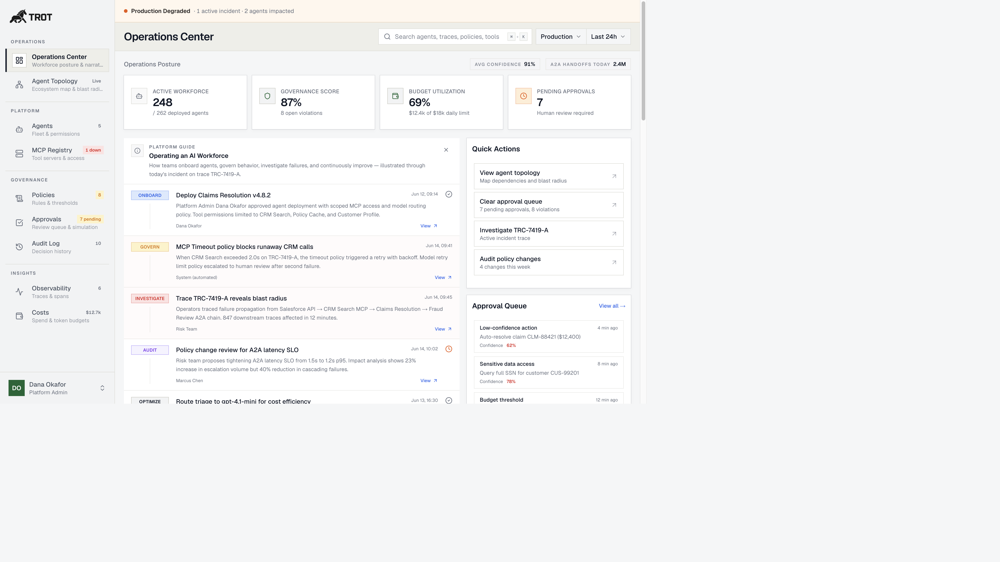
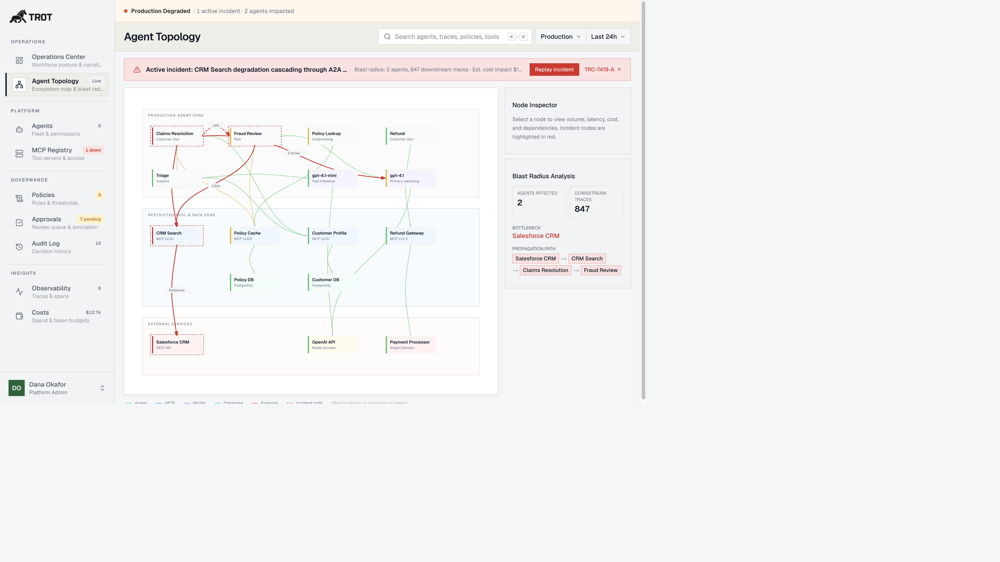
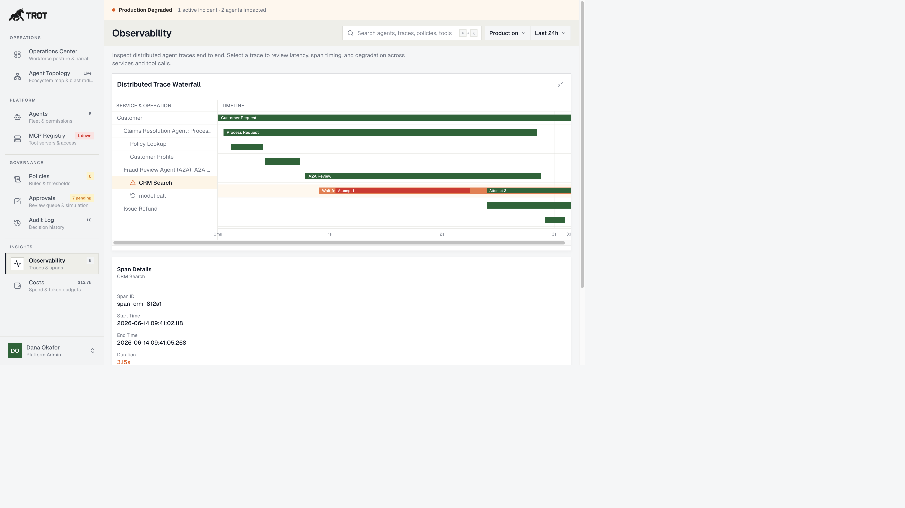

# TROT Agent Console

TROT is a frontend prototype of an operations console for a fleet of AI agents. The interface is built around an insurance-claims scenario: operators review fleet posture, inspect a degraded CRM Search incident (`TRC-7419-A`), and move between governance, tracing, and cost views. Every figure in the UI comes from static mock data. There is no backend, authentication, or live telemetry.

The npm package name is `nest-agent-poc`.

## Features

The sidebar in [`src/lib/navigation.ts`](src/lib/navigation.ts) groups the main routes:

| Section | Route | What the page shows |
| --- | --- | --- |
| Operations | `/` | Fleet posture, a dismissible workforce narrative, quick actions, an approval preview, alerts, and recent traces |
| Operations | `/topology` | SVG map of agents, MCP servers, models, and external services, with trust zones and a blast-radius panel |
| Platform | `/agents` | Filterable table of five named agents and a detail sheet |
| Platform | `/mcp-registry` | MCP server cards, connection counts, and a server detail sheet |
| Governance | `/policies` | Policy table, violations, and a policy detail sheet |
| Governance | `/approvals` | Pending-review list and a policy-simulation picker |
| Governance | `/audit` | Paginated audit events and an event detail sheet |
| Insights | `/observability` | Trace list and a span waterfall. `?trace=` selects a trace |
| Insights | `/costs` | Spend by agent and model, plus high-cost traces. `?agent=` highlights an agent |
| Account | `/settings`, `/settings/profile` | Profile, preferences, notifications, billing, members, and masked API-key placeholders. `?tab=` selects a settings tab |

Three additional pages are linked from tables and detail sheets. They are not sidebar items, and each page renders one fixture regardless of its query string:

- `/topology/replay` — playable timeline for the `TRC-7419-A` incident
- `/agents/lifecycle` — lifecycle stages for Claims Resolution
- `/policies/history` — version, simulation, and rollback view for the A2A latency SLO

Shared chrome includes a status banner derived from mock agent and MCP health, global search over pages, settings tabs, and trace IDs, and environment/time-range controls. Those controls show a loading overlay for 1.5 seconds. They do not change the underlying data.

Approve, deny, create-key, and revoke controls are present in the UI and do not update state.

## Screenshots

Production build, desktop viewport.







## Tech stack

- [Next.js](https://nextjs.org) 16.2.9 App Router, React 19, TypeScript
- Tailwind CSS 4 and [shadcn](https://ui.shadcn.com) components on Base UI
- Lucide icons
- Geist and Geist Mono via `next/font`

There is no chart library and no graph library. Spend bars, the topology map, and the trace waterfall are custom components.

## Architecture

```
src/app/(dashboard)/     route pages
src/components/          page workspaces, sheets, and shared chrome
src/lib/mock-data/       static fixtures
src/lib/types.ts         shared types
src/lib/navigation.ts    sidebar model and badge counts
src/lib/system-status.ts banner status derived from fixtures
```

Pages are server components that render client workspaces. Interaction state stays in the browser: selected rows, sheet open state, replay playhead, search query, and the dismissed workforce narrative (`localStorage` key `nest:workforce-narrative-dismissed`). Deep links that do change the view are `?trace=` on Observability, `?policy=` on Audit, `?agent=` on Costs, and `?tab=` on Settings.

The mock domain is a claims operation: Claims Resolution, Fraud Review, Policy Lookup, Refund, and Triage. Summary cards also show fleet-scale numbers (for example 248 of 262 agents) that are not backed by 262 agent records. Names, emails (`@nest.io`), phone numbers, Slack IDs, MCP endpoints, and API-key strings in the fixtures are fictional.

## Local setup

Requires Node.js and npm.

```bash
npm install
npm run dev
```

Open [http://localhost:3000](http://localhost:3000).

```bash
npm run build   # production build
npm start       # serve the production build
npm run lint    # ESLint
```

`npm run build` completes and prerenders the routes above. `npm run lint` currently reports errors in four files (`react-hooks/set-state-in-effect`) and warnings for unused imports and the `` used by the logo. There is no test suite.

## Repository notes

- `.gitignore` excludes `.env*`, `*.pem`, `.next/`, and `node_modules/`. No environment files are committed.
- `package.json` sets `"private": true`, which blocks accidental publication to npm.
- This repository does not include a license file. All rights reserved by the copyright holder unless a license is added.
